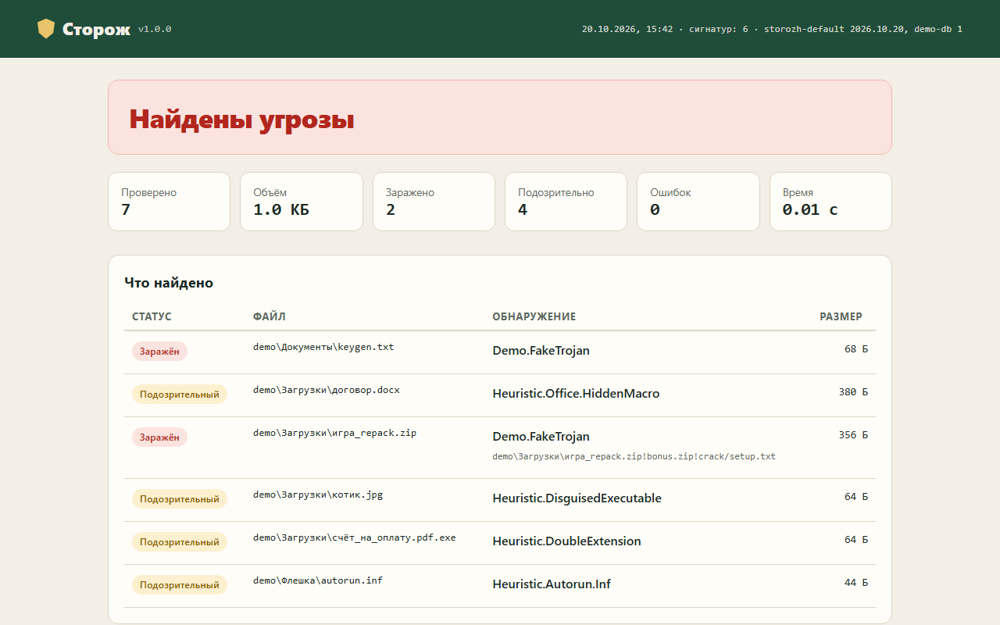

# Сторож: сканер файлов по сигнатурам и эвристикам

Небольшой антивирусный сканер на Python для проверки флешек, папки «Загрузки» и присланных архивов. Он ищет известные файлы по хэшам и байтовым шаблонам, ловит типичные уловки вроде `счёт.pdf.exe` или макроса, спрятанного в `.docx`, переносит находки в карантин и сохраняет понятный HTML-отчёт. Внешних зависимостей нет, только стандартная библиотека.




```text
$ storozh scan demo --db examples/custom-db.json --html report.html
НАЙДЕНО  demo/Документы/keygen.txt  Demo.FakeTrojan
ПОДОЗР.  demo/Загрузки/договор.docx  Heuristic.Office.HiddenMacro
НАЙДЕНО  demo/Загрузки/игра_repack.zip!bonus.zip!crack/setup.txt  Demo.FakeTrojan
ПОДОЗР.  demo/Загрузки/котик.jpg  Heuristic.DisguisedExecutable
ПОДОЗР.  demo/Загрузки/счёт_на_оплату.pdf.exe  Heuristic.DoubleExtension
ПОДОЗР.  demo/Флешка/autorun.inf  Heuristic.Autorun.Inf
--------------------------------------------
Сигнатур загружено:  6
Проверено файлов:    7 (1.0 КБ)
Заражено:            2
Подозрительно:       4
Время:               0.01 с
HTML-отчёт: report.html
```

## Возможности

**Сигнатуры**
- Хэши MD5, SHA-1 и SHA-256: подходят для конкретных известных файлов
- Байтовые шаблоны в hex с подстановками: `??` означает любой байт, `[2-8]` пропуск от 2 до 8 байт, `offset` привязывает шаблон к позиции в файле
- Текстовые шаблоны (`type: string`) для скриптов и макросов
- Встроенная база содержит только тестовый файл [EICAR](https://www.eicar.org/download-anti-malware-testfile/); свои базы подключаются через `--db`
- `storozh hash файл` сразу печатает готовую базу с хэшами файла, её можно сохранить и использовать

**Эвристики** (отключаются флагом `--no-heuristics`)
- Двойное расширение: `фото.jpg.scr`, `счёт.pdf   .exe`
- Символ RTLO в имени, который визуально переворачивает расширение
- Исполняемый файл (PE или ELF) под видом картинки, документа или музыки
- `autorun.inf` с командой запуска
- Макрос `vbaProject.bin` внутри `.docx`, `.xlsx` или `.pptx`: в этих форматах макросов быть не должно
- ZIP-бомба: архив, который разжимается в сотни раз и до десятков мегабайт

**Архивы**
- ZIP, TAR, TAR.GZ и одиночный GZ, вложенные архивы до трёх уровней
- В отчёте виден полный путь до находки: `repack.zip!bonus.zip!crack/setup.txt`
- Лимиты на размер записи, суммарный объём и число файлов, поэтому сканер не повиснет на огромном или испорченном архиве; зашифрованные записи отмечаются в заметках

**Обход и отчёты**
- Папки обходятся рекурсивно, символические ссылки пропускаются; исключения по маске `--exclude node_modules --exclude "*.iso"`
- Файлы больше `--max-size` (по умолчанию 200 МБ) пропускаются
- Цветной вывод в консоли, `--json` для скриптов и `--html` для отчёта, который можно открыть в браузере или отправить
- Коды выхода как у `clamscan`: 0 чисто, 1 есть находки, 2 только ошибки

**Карантин и кэш**
- `--quarantine` переносит заражённые файлы в `~/.storozh/quarantine`, `--quarantine-suspicious` ещё и подозрительные
- Содержимое маскируется XOR, поэтому файл в карантине нельзя случайно запустить, а другой антивирус его не тронет
- `restore` проверяет SHA-256 и не перезаписывает существующий файл без `--force`
- `--cache` хранит вердикты в SQLite: при повторной проверке неизменённые файлы не читаются заново; кэш сбрасывается сам при смене баз или настроек

## Стек

Python 3.10+, стандартная библиотека (`hashlib`, `re`, `zipfile`, `tarfile`, `sqlite3`, `argparse`), pytest, GitHub Actions.

## Запуск

```bash
git clone https://github.com/whysafe/storozh.git
cd storozh
pip install -e .
```

Проверить папку и сохранить отчёт:

```bash
storozh scan ~/Downloads --html report.html
```

Проверить флешку, переместить находки в карантин и не трогать большие образы:

```bash
storozh scan E:\ --quarantine --exclude "*.iso" --cache
```

Попробовать на безопасной демо-папке:

```bash
python examples/make_demo.py demo
storozh scan demo --db examples/custom-db.json --html report.html
```

Карантин:

```bash
storozh quarantine list
storozh quarantine restore 20261020124210a1b2c3
storozh quarantine delete 20261020124210a1b2c3
```

Своя база сигнатур:

```bash
storozh hash suspicious.exe --name Trojan.MyFind > my-db.json
storozh scan D:\Projects --db my-db.json
```

Формат базы:

```json
{
  "name": "my-db",
  "version": "1",
  "signatures": [
    {"name": "Trojan.MyFind", "type": "sha256", "value": "…64 hex…"},
    {"name": "Packer.UPX", "type": "hex", "value": "55 50 58 21 ?? [0-8] 0D 0A"},
    {"name": "Stub.MZ", "type": "hex", "value": "4D 5A 90 00", "offset": 0},
    {"name": "Script.Dropper", "type": "string", "value": "powershell -enc"}
  ]
}
```

`storozh eicar` создаёт тестовый файл EICAR. Он безвреден, но Защитник Windows или другой установленный антивирус, скорее всего, удалит его сразу после создания, это нормально.

## Как устроено

```
storozh/
  signatures.py  загрузка и проверка баз, компиляция hex-шаблонов в регулярные выражения
  engine.py      сканер: один проход по файлу, вложенные архивы, итоговый вердикт
  heuristics.py  проверки имени, заголовка файла и состава архива
  walker.py      обход папок, исключения, лимит размера
  quarantine.py  перенос, маскировка, восстановление с проверкой хэша
  cache.py       кэш вердиктов в SQLite
  report.py      консоль, JSON и HTML
  cli.py         команды scan, quarantine, hash, eicar, db
```

- Файл читается один раз блоками по 1 МБ: в одном цикле считаются все нужные хэши и ищутся шаблоны. Чтобы не пропустить шаблон на стыке блоков, к каждому блоку приклеивается хвост предыдущего длиной `максимальная длина шаблона − 1`.
- Шаблоны с `offset` проверяются только в своём месте и выбывают из поиска, как только позиция пройдена.
- Записи архива распаковываются в память в пределах лимитов и проверяются тем же движком, поэтому вложенность обрабатывается рекурсией без отдельного кода.
- Вердикт: любая сигнатура даёт «заражён», только эвристики дают «подозрительный».
- Ключ кэша состоит из пути, размера и `mtime_ns`, плюс «профиль»: отпечаток баз, настройки сканирования и версия программы.

## Тесты

```bash
pip install -e ".[dev]"
pytest -q
```

65 тестов: компиляция шаблонов, шаблон на границе блоков, привязка к смещению, вложенные ZIP и TAR.GZ, ZIP-бомба, все эвристики и ложные срабатывания, карантин с проверкой целостности, кэш, команды CLI и коды выхода. Тесты не пишут EICAR на диск, вместо него используется безобидная строка-маркер, иначе Защитник Windows удалял бы тестовые файлы. CI на GitHub Actions запускает тесты на Python 3.10, 3.12 и 3.13 и прогоняет сканер на демо-папке.

## Ограничения

Это учебный и вспомогательный инструмент. Он хорошо находит то, что описано в базе, и типичные уловки с именами и форматами, но не заменяет полноценный антивирус с поведенческим анализом и обновляемыми базами.

## Автор

**whysafe** — fullstack- и Unity-разработчик, на фрилансе с 2023 года. Python, JavaScript/TypeScript, PHP, Java, Kotlin, C#/Unity, C/Assembly, Linux, базы данных, AI/ML и серверная разработка.

- Сайт: [whysafe.ru](https://whysafe.ru)
- Telegram: [@yawhysafe](https://t.me/yawhysafe) · канал [@whysafe_official](https://t.me/whysafe_official)
- Kwork: [kwork.ru/user/whysafe](https://kwork.ru/user/whysafe)
- Почта: [hello@whysafe.ru](mailto:hello@whysafe.ru)
